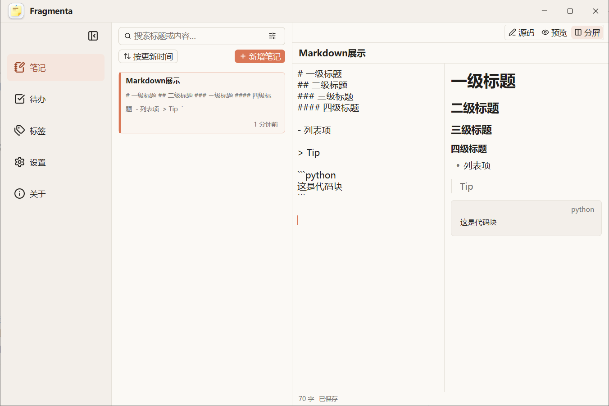
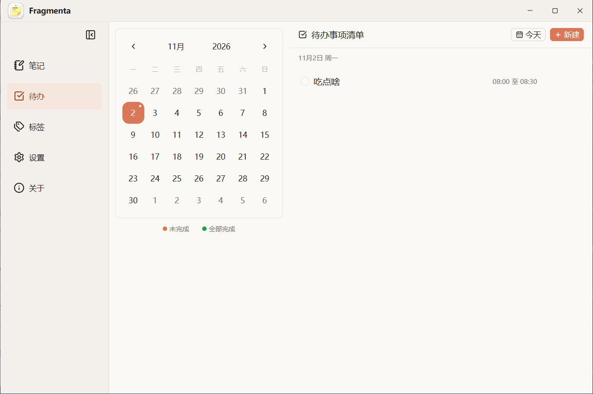
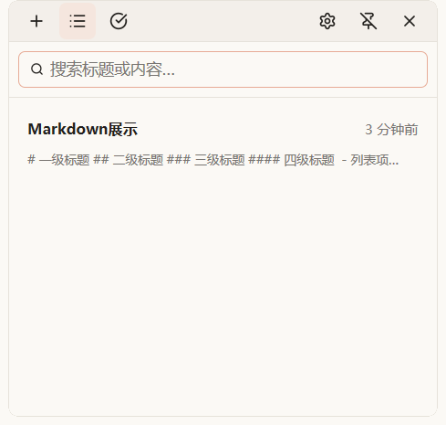
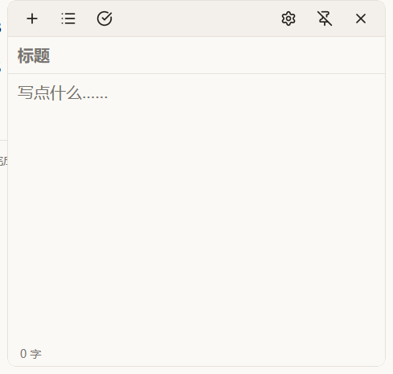
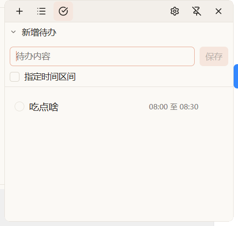

<p align="center">
  
</p>

<h1 align="center">Fragmenta</h1>

<p align="center">
  <a href="https://www.rust-lang.org/"></a>
  <a href="https://crates.io/crates/gpui-kit"></a>
  <a href="https://www.sqlite.org/"></a>
  <a href="https://github.com/anewdo/Fragmenta/releases"></a>
</p>

Fragmenta 是一款轻量的 Windows 桌面速记与笔记管理应用：基于Rust GPUI Kit构建，原生桌面App，无WebView开销，常驻内存低、应用体积小，以单个 exe 绿色便携分发，免安装，复制到任意可写目录即可运行。

## 功能

### Markdown 预览与编辑



### 待办事项



### 快捷便笺





### 内存占用

|                        | 后台    | 常驻      |
| ---------------------- | ------- | --------- |
| 基础占用               | ≈2~3MB | ≈2~3MB   |
| 以下数据都计算基础占用 | /       | /         |
| 主窗口                 | /       | ≈10~15MB |
| 单个小窗               | /       | ≈9~12MB  |
| 5个小窗                | /       | ≈12~13MB |

## 快速开始

### 下载与运行

1. 打开 [Releases](https://github.com/anewdo/Fragmenta/releases)，下载最新的 `Fragmenta_vX.Y.Z_x64.exe`。
2. 将 exe 放到任意有写入权限的目录（避免 `Program Files` 等受保护位置），双击运行，无需安装。
3. 首次运行如遇 SmartScreen 提示，点击「更多信息」→「仍要运行」。
4. 按 `Ctrl+Alt+N` 呼出快捷便笺窗口；托盘图标可打开主窗口。

### 文件组织

默认布局：

- `Fragmenta.exe`：应用本体。
- `settings.json`：应用设置，同时是定位数据目录的唯一线索。
- `data/`：数据目录，内含 `fragmenta.db`（笔记与待办）和 `imgs/`（图片图库）。

使用建议：

- 移动或备份时，把 exe、`settings.json` 与 `data/` 作为一个整体处理，不要只移动 exe。
- 升级时先退出应用，再用新 exe 覆盖旧 exe，保留 `settings.json` 与 `data/`。
- 更换数据位置时使用设置页的「更改存储路径」，由应用完成迁移；不要手动搬动或删除 `fragmenta.db`、`imgs/`。
- 备份时先退出应用，再复制整个目录；应用运行期间不要移动或删除 `data/` 中的文件。
- 修改设置请在应用内进行，不要手动编辑或删除 `settings.json`。

## 从源码构建

### 环境要求

- Windows 10 / 11 x64
- Rust stable 工具链（支持 edition 2024，即 1.85 及以上）
- MSVC 目标 `x86_64-pc-windows-msvc`，以及 Visual Studio Build Tools（MSVC 编译器与 Windows SDK）
- Git

### 构建

```bash
git clone https://github.com/anewdo/Fragmenta.git
cd Fragmenta
cargo build --release --locked
```

产物为 `target/release/fragmenta.exe`。开发调试可直接运行：

```bash
cargo run
```
